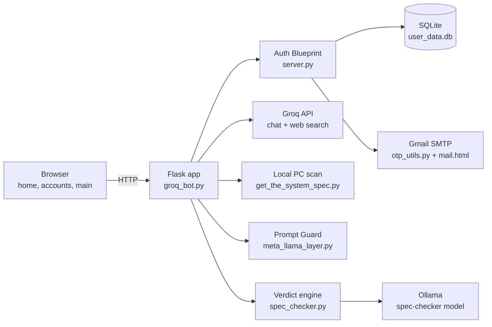
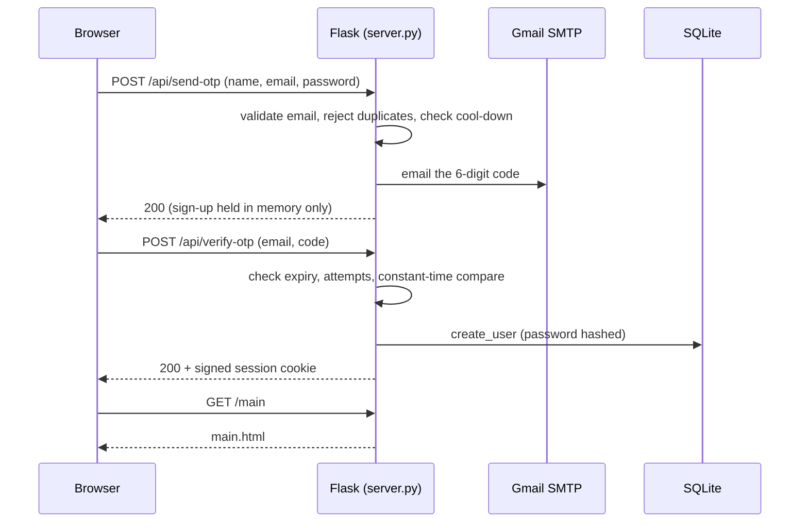
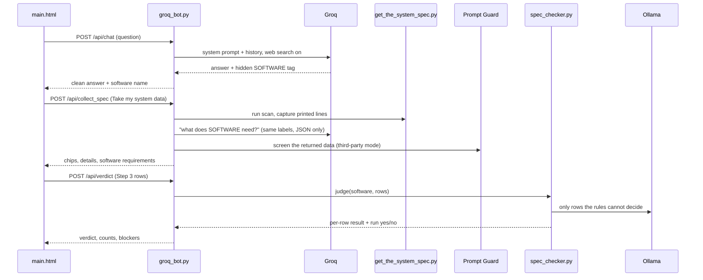

# GPS — Get PC Specs

> **Know if it runs, before you download.**

Finding out whether a PC can run a game, app or local AI model is normally a manual chore. You dig through Windows settings, Task Manager and Device Manager to learn your CPU, GPU, RAM, free disk space, OS version, etc. Then you hunt across store pages, vendor sites and forums for the software's requirements, decode the jargon (`VRAM`, `SSE4.2`, `min` / `rec`), and compare the two lists by hand, hoping you did not mix up a minimum with a recommended spec. **GPS puts all of that in one place.** It reads a wide set of real system information from your Windows PC, fetches the software's requirements, and shows both **side by side, row by row**. It ends with one plain answer, **Yes, it runs** or **No, it won't run**, with every part spelled out, before you spend hours downloading something that fails at 99%.

Under the hood it is a full-stack web app: an animated landing page, an email-verified account system, and a chat + scan + verdict dashboard that is only available after sign-in. What used to take many sources, many tabs and careful manual comparing becomes a single dashboard. A hosted LLM (Groq) gathers the software's requirements, and a prompt-injection classifier (Meta Prompt Guard) screens that data. Handing your system specs to an LLM that is not local is not safe, so GPS never does it: the scan stays on your machine, Groq only sees the software name and the field labels, and the comparison is done by plain deterministic code plus a local LLM (Ollama). That keeps the answer explainable rather than a guess, and keeps your hardware data private.

---

## Table of contents

1. [The idea](#1-the-idea)
2. [What this project demonstrates](#2-what-this-project-demonstrates)
3. [User journey](#3-user-journey)
4. [Tech stack](#4-tech-stack)
5. [Directory structure](#5-directory-structure)
6. [File-by-file guide](#6-file-by-file-guide)
7. [Data flow](#7-data-flow)
8. [Verification and protection](#8-verification-and-protection)
9. [Configuration (`.env`)](#9-configuration-env)
10. [Installation and running](#10-installation-and-running)
11. [Troubleshooting](#11-troubleshooting)
12. [Known limitations and roadmap](#12-known-limitations-and-roadmap)
13. [What not to commit to git](#13-what-not-to-commit-to-git)

---

## 1. The idea

**The problem.** System requirements are scattered across store pages and written in jargon (`VRAM`, `SSE4.2`, `min` / `rec`). Your own specs are buried in Windows settings. People download 80 GB, wait hours, and then hit `ERR_REQUIREMENTS_NOT_MET`.

**The solution.** GPS does three things:

1. **Scan** — reads your real CPU, GPU, RAM, disk and OS locally.
2. **Compare** — asks an LLM for the software's real requirements, using the *same labels* as the scan so the two can be lined up side by side, then judges each row.
3. **Decide** — shows one verdict (yes / no) with a pass / partial / fail result per component.

Because the comparison lives in code, the verdict is explainable: every row shows what the software needs, what your PC has, and *how* the result was reached (an exact calculation, or the local model).

---

## 2. What this project demonstrates

| Area | What is in the code |
|---|---|
| **Full-stack web** | Flask backend, Blueprint-based auth module, SQLite storage, three animated front-end pages with no framework |
| **Authentication** | Email OTP sign-up, password sign-in, forgot-password reset, signed session cookie, route-level access control |
| **Security** | Hashed passwords, expiring one-time codes, attempt limits, resend cool-down, constant-time comparison, HttpOnly cookies, protected API, no direct file access |
| **LLM engineering** | Groq chat with live web search, multi-key failover, a second LLM call that returns strict JSON, system-prompt rules that stop the model inventing numbers |
| **AI safety** | Meta Prompt Guard screens LLM-sourced data before it is shown or judged |
| **Hybrid reasoning** | Exact rule-based checks first (arithmetic, versions, units), local Ollama model only for what rules cannot decide |
| **Systems programming** | Windows hardware scan using `ctypes`, `winreg`, `wmic` / PowerShell, `psutil` |
| **Front-end craft** | GSAP timelines, scroll-driven storytelling, custom markdown + table renderer, theme and speed settings, reduced-motion support |
| **Email** | Responsive HTML email with dark mode and animation, plain-text fallback |

---

## 3. User journey

1. **Landing page (`/`)** — a 12-section scroll story: what GPS is, why the problem exists, how GPS fixes it. The last section has a **Scan my PC ↗** link.
2. **Account page (`/accounts`)** — create an account (name, email, password). A 6-digit code is emailed; typing it verifies the address. Existing users sign in; forgotten passwords are reset with another emailed code.
3. **Dashboard (`/main`)** — only reachable when signed in:
   - **Messages** — chat with GPS about any game, app or AI model.
   - **Step 1 · Scan** — *Take my system data* reads your PC and fetches the requirements of the software you last discussed.
   - **Step 2 · Reading your hardware** — animated snapshot of every value read.
   - **Step 3 · Your software meets your PC** — requirements and your hardware side by side.
   - **Step 4 · Can you run it?** — pass / partial / fail per row and the final verdict.

---

## 4. Tech stack

| Layer | Technology |
|---|---|
| Backend | Python 3.10+, Flask (Blueprints, sessions) |
| Database | SQLite (`sqlite3`), Werkzeug password hashing |
| Hosted LLM | Groq API, model `openai/gpt-oss-120b`, `browser_search` tool |
| Local LLM | Ollama, custom model named `spec-checker` |
| AI safety | Hugging Face `transformers`, `meta-llama/Prompt-Guard-86M` (PyTorch) |
| Hardware scan | `ctypes`, `winreg`, `wmic` / PowerShell, `psutil`, `platform`, `shutil` |
| Email | `smtplib` over SSL (Gmail), `email.message.EmailMessage` |
| Front-end | Vanilla HTML / CSS / JS, GSAP 3.12 + TextPlugin (CDN), Geist and Geist Mono fonts |

---

## 5. Directory structure

```
GPS/                                  <- main folder (name it anything)
├── .env                              <- secrets, NOT committed (see section 9)
├── requirements.txt                  <- pip install -r requirements.txt
├── README.md
│
├── screens/                          <- everything the browser sees
│   ├── home.html                     <- animated landing page
│   ├── accounts.html                 <- sign up / verify / sign in / reset
│   ├── main.html                     <- chat + scan + verdict dashboard (login required)
│   └── mail.html                     <- HTML template of the verification email
│
├── storage/
│   ├── db_utils.py                   <- SQLite user table + password helpers
│   └── user_data.db                  <- created automatically on first run
│
├── user_data_verification/
│   ├── server.py                     <- auth routes (Flask Blueprint)
│   └── otp_utils.py                  <- OTP generation + email delivery
│
└── models/
    ├── groq_bot.py                   <- THE server: run this file
    ├── get_the_system_spec.py        <- Windows hardware scanner
    ├── meta_llama_layer.py           <- Prompt Guard wrapper
    └── spec_checker.py               <- verdict engine (rules + Ollama)
```

> **Rename note:** `spec-checker.py` must be saved as **`spec_checker.py`**. A hyphen cannot be imported in Python. (`groq_bot.py` also falls back to the old file names, but the underscore name is the intended one.)

All paths in the code are resolved relative to each file, so you can start the server from any working directory.

---

## 6. File-by-file guide

### `screens/home.html` — landing page

An animated, scroll-driven product story built with GSAP.

- **12 micro-sections**, each a full-screen slide grouped into 5 chapters: *Intro, Problem, Versus, Data flow, Solution*.
- A 1920 × 1080 "stage" is scaled to fit any screen; each slide plays its own timeline once it is about a quarter visible (after a short dwell), holds its last frame, and replays if you come back from two or more sections away.
- **Auto-advance:** after a section finishes, the page scrolls on by itself unless you are mid-scroll.
- Page chrome: top progress bar, chapter dots (click to jump), a "Scroll to explore" hint, and a "Next · section title ↓" cue under finished slides.
- Motion graphics details: typed terminal commands, letter-by-letter headline reveals, a rolling word box (download / buy / update / install), colour-wipe transitions, a fake download that fails at 99%, packet animations along the data-flow wires, and a Figma-style selection box plus a guided cursor tagged `GPS`.
- Respects `prefers-reduced-motion`: with it on, slides jump to their final frame and the auto-advance and bobbing hints are disabled.
- **Entry point to the app:** the final section's **Scan my PC ↗** text is a real link to `/accounts`. A small CSS rule re-enables clicks on that one link (the chapter layer itself ignores pointer events) without changing the animation.

### `screens/accounts.html` — sign up, verify, sign in, reset

One page with two views (`sign up` / `sign in`) switched from a strip at the bottom. Only one form is on screen at a time.

- **Sign up:** full name, email, password (with show / hide eye). *Create account* asks the server to email a code.
- **Verify box ("Check your email"):** six single-digit boxes with auto-advance, Backspace to go back, and paste support (pasting `123456` fills the row). When all six digits are entered the page verifies them automatically and shows **✓ verified**, then opens the app.
- **Sign in:** email + password, checked by the server. Success plays the button-press animation and opens the app.
- **Forgot password:** from the sign-in form, the same code box appears; after the code is verified a **New password** form lets the user save a new password, then returns to sign-in with `// password updated, sign in`.
- **Status line** in the strip (`// signing up`, `// sending code…`, `// Wrong code`, …) shows progress and server errors in the page's own style.
- **Two pointers:** a guided cursor tagged `GPS` plays the intro demo, while a second blue pointer tagged `user` follows the real mouse (desktop, motion allowed).
- Intro (hero + colour wipe) plays only on the first visit; later switches go straight to the form.
- Calls `POST /api/send-otp`, `/api/verify-otp`, `/api/reset-password`, `/api/sign-in`.

### `screens/mail.html` — verification email template

A single HTML email with placeholders that `otp_utils.py` fills in: `{{OTP}}`, `{{D1}}`…`{{D6}}` (one per digit box), `{{EXPIRY_MINUTES}}`, `{{EXPIRY_TIMECODE}}`, `{{EMAIL}}`.

- Core styling is inline so it survives mail clients that strip `<style>`.
- Progressive enhancement: entrance animations, dark mode (`prefers-color-scheme`) and small-screen tweaks in a `<style>` block; Geist fonts where the client allows web fonts, system fonts otherwise.
- Hidden preview text for the inbox list ("Your code is 123456. It expires in 5 minutes.").
- Footer tells recipients who did not request it to ignore the mail.
- If this file is missing, the email is still sent as plain text.

### `screens/main.html` — dashboard (login required)

**Layout and chrome**

- Fixed side bar: *Messages*, *Scan*, *Settings*. A sliding indicator follows the active tab; a top progress bar tracks scroll.
- **Composer** (the input bar) sits at the bottom while you chat and docks to the top, dimmed, once you scroll down to the scan steps; hovering or focusing it brings it back. Press **`/`** anywhere to focus it. While idle it types example questions as its placeholder.
- **Settings panel:** theme (*Auto / Light / Dark*), animation speed (*Slow / Normal / Fast*, applied to the global GSAP timeline), and *Clear chat* (also resets the server's conversation memory).
- A reload starts clean: the page calls `/api/reset` so the server forgets the previous software and chat.
- Second "user" pointer that follows the mouse with the same glide and click-press as the guided one (fine-pointer desktops only).

**Chat**

- Messages go to `POST /api/chat`. While waiting, a bouncing-dots bubble is shown.
- A custom **markdown renderer** (`md()`) handles headings, bold / italic / inline code, bullet and numbered lists, and tables. All text is rendered first and **every table is gathered at the end** under a "Tables" label, matching the rule given to the model. Table titles are taken from the line above each table. All text is HTML-escaped before rendering.
- Long answers open at their **first line**: after a reply arrives, the page scrolls to the top of that reply (never past the end of the chat), so you read from the top instead of being thrown to the bottom.
- Errors (no server, 401, API errors) appear as a chat message instead of failing silently.

**Scan, compare, decide** (each step is its own scroll-triggered animated scene)

- **Step 1** — typed `gps scan --local` command, five chips (CPU, GPU, RAM, Disk, OS) filled with real values by a typing effect after **Take my system data**. Shows success / failure messages for the software-spec and Prompt Guard stages under the button.
- **Step 2** — every scanned line appears as a row with a scanning bar, flying data packets, a progress bar and a "Reading X…" status. Noisy lines (GPU adapter RAM, driver versions, .NET Framework versions) are never shown.
- **Step 3** — the heading follows the software you last chatted about. Rows show *Software needs* vs *Your PC*; a row with `N/A` on either side is dropped. A footer notes `Prompt Guard passed · N values`.
- **Step 4** — one row per component with a **Pass / Partial / Fail** pill (hover for the calculation and whether it came from an *exact check* or the *model*), followed by the verdict panel: *"Yes. It runs."* with a drawing tick and sheen, or *"No. It won't run."* with a drawing cross, shake and red pulse; failed rows are highlighted. A sentence explains blockers or weak spots, and counters show pass / partial / fail totals. Buttons: *Replay the demo* and *Ask GPS a question*.
- Handles stale answers: if you ask about a different software while a verdict is still being computed, the old answer is ignored.
- Dark mode, reduced-motion support and a responsive layout down to phone width.

### `models/groq_bot.py` — the server (run this file)

The single Flask application that serves the pages and hosts all APIs. It registers the auth Blueprint from `server.py`.

**Chat with the hosted LLM**

- **System prompt rules:** look up *official* requirements with web search; use only figures found or calculated; write "not published" instead of guessing; never invent hardware names; for local AI models compute memory from parameter count (`weights GB = billions of parameters × bytes per weight` — FP16 = 2, Q8 = 1, 4-bit ≈ 0.6 — plus 1–2 GB for context and runtime); give a minimum build and a comfortable build; say "not required" when no GPU is needed; list the sources actually opened.
- **Answer format rules:** explanation first, tables only at the very end, no emojis.
- **Software tag:** every answer ends with a hidden `[[SOFTWARE: name]]` tag. The server strips it (including a half-cut tag) and remembers the name as `last_software`. `NONE` keeps the previous software.
- **Web search** via Groq's `browser_search`; if Groq rejects the tool the call is retried without it. Citation markers like `【2†L119-L124】` are stripped from the text.
- **Key failover:** `GROQ_API_KEYS` holds several keys; the server starts with the last key that worked and rotates on failure. A bad request is *not* rotated (it would fail on every key).
- Conversation history is kept in memory so follow-up questions have context.

**Scan** — `POST /api/collect_spec`

1. Runs `get_the_system_spec.main()` and captures everything it prints (one scan at a time, guarded by a lock).
2. `parse_spec_lines` turns each `Label: value` line into data.
3. `summarize_spec` builds the five **chips**: CPU (vendor and marketing noise removed), GPU (a dedicated card wins over an integrated one), RAM in GB, free disk space on the system drive, and OS (Windows 11 is detected from build number ≥ 22000, because older Python reports it as "10"). Everything else becomes **details** for Step 2.
4. `fetch_software_spec` asks Groq (a second, separate "data service" prompt, temperature 0.1) for the software's needs **using exactly the same labels as the scan**, returned as strict JSON. Rules inside the prompt convert units (GB → bytes, GHz → MHz) and map names to the scan's style. Only the requested labels survive, values are flattened and capped in length.
5. The result is run through **Prompt Guard** (see below). The response contains `software.ok`, a `stage` (`none` / `groq` / `guard` / `done`) and a human-readable `message`, so the UI can tell the user exactly which stage failed.

**Verdict** — `POST /api/verdict` passes the Step 3 rows to `spec_checker.judge()`.

**Other routes** — `GET /api/software`, `POST /api/reset`, pages at `/`, `/home.html`, `/main`, `/main.html`.

**Protection built in:** `static_folder=None` (no raw file serving), `before_request` login gate, signed session cookie (`SECRET_KEY`), `Cache-Control: no-store` on every response, Prompt Guard loaded in a background thread at start-up.

### `models/get_the_system_spec.py` — hardware scanner (Windows)

Prints one `Label: value` line per fact so the output is trivially parseable.

| Source | What it reads |
|---|---|
| `platform` | OS name, release, version, machine type, architecture |
| `winreg` | Marketing CPU name from the registry (falls back to `platform.processor()`) |
| `os` / `psutil` | Logical core estimate; exact physical / logical cores and max clock (MHz) |
| `ctypes` → `GlobalMemoryStatusEx` | Total RAM, available RAM, memory load % |
| `shutil` | Free and total bytes of every drive letter that exists |
| `wmic`, then PowerShell `Get-CimInstance` | GPU names (PowerShell is the fallback if `wmic` is missing) |

> `psutil` is effectively required: without it the scanner prints a "not installed" line that would otherwise show up as a stray row in Step 2.

The scanner uses Windows-only APIs. On other operating systems the web app still runs, but **Take my system data** returns an error.

### `models/spec_checker.py` — verdict engine

`judge(software, rows)` grades every row as **pass / partial / fail** and decides whether the software runs. It is deliberately **hybrid**: arithmetic is done in code (small models are unreliable at sums), and the local model is only asked about things that are a matter of judgement.

**Exact rule checks (`src: "rule"`)**

| Situation | Result |
|---|---|
| Software needs nothing (`N/A`, `any`, `not required`) | pass |
| PC value is unknown | partial |
| OS version build numbers | pass if PC build ≥ required |
| OS name | fail if the family differs (Windows / macOS / Linux); otherwise compares version numbers |
| Architecture | x64 satisfies x86; arm64 running x64 → partial (emulation); anything else → fail |
| Vague CPU needs ("modern", "multi-core", "64-bit") | pass |
| Quantities with units (B / KB / MB / GB / TB, MHz / GHz, core counts) | ratio PC ÷ need: **≥ 0.97 pass, ≥ 0.6 partial, below that fail** |
| Disk / "free space" rows | pass or fail only (no space, no install) |
| "Available …" rows (live readings) | shown but never block |
| Same part name on both sides | pass |

**Model check (`src: "model"`)** — for rows like CPU and GPU model names, the local Ollama model gets a single-line prompt ("A or B, which is better in performance, answer in one word") with `temperature 0`. The one-word reply is read as *PC is stronger*, *similar*, or *software needs more*. An identical pair is only asked once. If the reply cannot be read the row becomes **partial ("not judged")**, never a silent pass.

**Safeguards**

- *Spare hardware:* several drives or GPUs share one requirement. If one passes, the others' failures are demoted to informational so a spare drive cannot block the result.
- *Final answer:* the software runs when **no row failed**. The result includes `counts`, `blockers` (failed labels), `weak` (partial labels) and the model name.
- Limits: at most 60 rows, long strings trimmed, `|` characters removed, 8192-token context so Ollama does not silently cut the prompt.
- Failures surface as a clean `OllamaError` ("Could not reach Ollama at … check that the model exists") which the API returns as HTTP 502.

**Extra modes**

- `python spec_checker.py --demo` grades a built-in sample table.
- `python spec_checker.py` starts an interactive chat with the model and saves the transcript to `spec_checker_chat_<timestamp>.txt` on Ctrl+C.
- Environment overrides: `SPEC_CHECKER_MODEL`, `OLLAMA_HOST`.

### `models/meta_llama_layer.py` — Prompt Guard wrapper

Loads Meta's `Prompt-Guard-86M` text-classification model once and exposes `check_prompt(text, source, threshold=0.5)`.

- `source="user"` blocks only **JAILBREAK** (direct attempts to override the model).
- `source="third_party"` blocks **INJECTION** and **JAILBREAK** (documents, web pages, tool output).
- Returns `{label, score, blocked}`. Input is truncated to 512 tokens.
- Running the file directly runs a small self-test with five sample prompts.

In this app it is applied to the **LLM-generated software-requirement data** before it is shown or judged (see section 8).

### `user_data_verification/server.py` — auth Blueprint

All sign-up, sign-in, OTP and reset routes (see section 7 for the full API table).

- Holds pending sign-ups and resets in memory (`pending`), keyed by email, with expiry, attempts, resend time and a `verified` flag.
- A **new account is only written to the database after its code is verified**.
- Starting a session (`session["email"]`, `session["name"]`) after a verified sign-up or a correct sign-in is what unlocks `/main`.
- Also serves `accounts.html` at `/accounts` and `/accounts.html`.
- Not a standalone server any more: running it directly just prints how to start the app.

### `user_data_verification/otp_utils.py` — OTP and email

- `generate_otp()` — six digits from `secrets.randbelow` (cryptographically secure, never loses a leading zero).
- `send_otp()` — builds a multipart email (plain-text fallback + HTML from `mail.html`) and sends through Gmail over SSL (port 465).
- Reads credentials from `.env` with a small built-in parser (comments, quotes and `export` supported, no extra package). **Real environment variables win over the file.** Fails fast with a clear message if `SENDER_EMAIL` / `APP_PASSWORD` are missing.
- Template values are HTML-escaped where user-supplied.

### `storage/db_utils.py` — database layer

SQLite table `users(email PRIMARY KEY, user_name, password_hash, created_at)`.

| Function | Purpose |
|---|---|
| `init_db()` | Create the table if missing (safe to call every start) |
| `email_exists(email)` | Duplicate check |
| `create_user(name, email, password)` | Insert; the password is hashed first; the primary key blocks duplicates at DB level |
| `update_password(email, new_password)` | Replace the hash; reports whether a row changed |
| `verify_login(email, password)` | Returns `(True, name)` or `(False, None)` using Werkzeug's hash check |

All queries are parameterised. The database file always sits next to `db_utils.py`, regardless of the working directory.

---

## 7. Data flow

### 7.1 Big picture



### 7.2 Sign-up and verification



- **Sign in** is `POST /api/sign-in` → `verify_login` → session cookie → `/main`.
- **Forgot password:** `POST /api/send-otp` with `reset: true` (only for existing accounts) → `POST /api/verify-otp` marks the entry verified (this does **not** sign the user in) → `POST /api/reset-password` replaces the hash → user signs in with the new password.

### 7.3 Chat, scan and verdict



### 7.4 API reference

**Public routes**

| Method | Path | Purpose |
|---|---|---|
| GET | `/`, `/home.html` | Landing page |
| GET | `/accounts`, `/accounts.html` | Account page |
| POST | `/api/send-otp` | Email a code (sign-up, or reset when `reset: true`) |
| POST | `/api/verify-otp` | Check the six digits; a sign-up verified here is saved and signed in |
| POST | `/api/reset-password` | Set a new password (only after a verified reset code) |
| POST | `/api/sign-in` | Email + password login, starts the session |

**Protected routes** (no valid session → page redirects to `/accounts`, API returns `401 {"error": "Sign in first"}`)

| Method | Path | Purpose |
|---|---|---|
| GET | `/main`, `/main.html` | The dashboard |
| POST | `/api/chat` | Chat with GPS |
| GET | `/api/software` | Name of the software last discussed |
| POST | `/api/collect_spec` | Scan the PC and fetch the software's requirements |
| POST | `/api/verdict` | Judge the Step 3 rows |
| POST | `/api/reset` | Forget conversation and software |

---

## 8. Verification and protection

### Account verification

| Protection | How it works |
|---|---|
| **Email ownership proof** | A 6-digit OTP must be entered before an account is created. Until then nothing is written to the database. |
| **Secure code generation** | `secrets.randbelow`, not `random`. |
| **Expiry** | Codes live 5 minutes (`OTP_TTL`); the email says so. |
| **Attempt limit** | 5 wrong guesses discard the code (`MAX_ATTEMPTS`); the server answers `429`. |
| **Resend cool-down** | 30 seconds between codes for the same address (`RESEND_COOLDOWN`). |
| **Constant-time comparison** | `secrets.compare_digest` prevents timing attacks on the code. |
| **One-time use** | A pending entry is removed once used. |
| **Input validation** | Strict email regex (a single plain address: no commas, quotes or `<>`, which also blocks header injection into the email), name and password required. |
| **Duplicate protection** | `email_exists` check plus the primary key; a race between two sign-ups is caught as `IntegrityError` → `409`. |
| **Reset safety** | A reset code is only sent to an address with an account; `reset-password` refuses unless the code was verified and still valid; resetting does not log the user in. |

### Passwords

- Stored only as **salted hashes** (Werkzeug `generate_password_hash`; Werkzeug 3 uses scrypt). Plain text never reaches the database.
- Login uses `check_password_hash`.
- Wrong email and wrong password give the same message (`Wrong email or password`).

### Access control

- **Session gate:** a `before_request` hook allows `/main` and the five dashboard APIs only when the signed session cookie contains a verified user.
- **No file leaks:** Flask's static serving is turned off (`static_folder=None`). Pages are served only by explicit routes, so `/main.html` cannot be fetched around the gate and `mail.html` or the database are never reachable.
- **Session hardening:** `HttpOnly` (JavaScript cannot read it), `SameSite=Lax`, cookie signed with `SECRET_KEY`, and `session.clear()` before logging in.
- **No stale pages:** `Cache-Control: no-store` on every response.

### AI and data safety

- **Prompt Guard** screens the LLM-generated requirement data (treated as *third-party content*, so both INJECTION and JAILBREAK block it) in chunks of about 1,200 characters; the worst chunk decides. If the check fails or the content is blocked, the UI says which stage failed and Step 3 stays empty instead of showing unchecked data.
- **No-guessing rules** in both Groq prompts: official sources only, "not published" / `N/A` instead of invented numbers, and a "Sources:" line when web search was used.
- **Strict data contract:** the requirements call returns JSON for *exactly* the labels the scan produced; unknown labels are discarded and every value is capped in length.
- **Deterministic first:** arithmetic and version checks are done in code, not by the model. An unreadable model answer is "partial", never "pass".
- **Output escaping:** the front end escapes all text before building HTML, so model output cannot inject markup into the page.

### Privacy and secrets

- The hardware scan runs **on the machine hosting the app** and is only sent to Groq in the form of labels, not as raw system dumps; the requirement lookup sends the *software name* and labels, not your specs.
- Credentials (SMTP, Groq, Hugging Face, session secret) live in `.env` and real environment variables, never in the code.

---

## 9. Configuration (`.env`)

Create `.env` in the **main folder** (next to `screens/`, `models/`, …).

```env
# --- email (OTP delivery) ---
SENDER_EMAIL=your_address@gmail.com
APP_PASSWORD=your_16_char_google_app_password

# --- Groq (comma separated; several keys = automatic failover) ---
GROQ_API_KEYS=gsk_key1,gsk_key2

# --- Hugging Face (for the gated Prompt Guard model) ---
HF_TOKEN=hf_xxxxxxxxxxxxxxxxxxxx

# --- session signing (recommended) ---
SECRET_KEY=put-a-long-random-string-here
```

| Variable | Required | Used by | Notes |
|---|---|---|---|
| `SENDER_EMAIL` | Yes | `otp_utils.py` | Gmail address that sends the codes |
| `APP_PASSWORD` | Yes | `otp_utils.py` | A Google **App Password** (needs 2-Step Verification), not your normal password |
| `GROQ_API_KEYS` | Yes | `groq_bot.py` | One or more keys, comma separated |
| `HF_TOKEN` | Yes | `meta_llama_layer.py` | Read token; you must also accept the model's licence on Hugging Face |
| `SECRET_KEY` | Recommended | `groq_bot.py` | Without it a random key is made at each start, which logs everyone out on restart |
| `SPEC_CHECKER_MODEL` | No | `spec_checker.py` | Ollama model name, default `spec-checker` |
| `OLLAMA_HOST` | No | `spec_checker.py` | Default `127.0.0.1:11434` |

Generate a secret key with: `python -c "import secrets; print(secrets.token_hex(32))"`

---

## 10. Installation and running

**Requirements:** Windows 10 / 11 (for the scanner), Python 3.10+, an internet connection, and [Ollama](https://ollama.com) installed.

```bash
# 1. get the code and enter the main folder
git clone <your-repo-url>
cd GPS

# 2. (recommended) virtual environment
python -m venv .venv
.venv\Scripts\activate

# 3. install dependencies
pip install -r requirements.txt
```

**4. Create `.env`** as shown in section 9.

**5. Prompt Guard access.** Create a Hugging Face account, open the `meta-llama/Prompt-Guard-86M` model page, accept its licence, and put a read token in `HF_TOKEN`. The model downloads on the first start.

**6. Local verdict model.** Make sure Ollama is running and a model called `spec-checker` exists (`ollama list`). Create it with `ollama create spec-checker -f Modelfile` using the base model of your choice, or point `SPEC_CHECKER_MODEL` at an existing model.

**7. Start the app** (this is the only server you run):

```bash
python models/groq_bot.py
```

**8. Open** <http://127.0.0.1:5000/> in the browser. Do not open the `.html` files directly: the pages call `/api/*`, which only exists when served by Flask.

Optional checks:

```bash
python models/get_the_system_spec.py     # prints your raw scan
python models/spec_checker.py --demo     # grades a sample table with Ollama
python models/meta_llama_layer.py        # Prompt Guard self-test
```

---

## 11. Troubleshooting

| Symptom | Likely cause and fix |
|---|---|
| `RuntimeError: SENDER_EMAIL / APP_PASSWORD not found` at start | `.env` is missing, in the wrong folder, or lacks those two lines |
| `Could not send the email` (502) | Wrong Gmail App Password, or 2-Step Verification is off |
| `Wait Ns before requesting another code` | The 30-second resend cool-down is working as intended |
| `Code expired, request a new one` | More than 5 minutes passed, or the server restarted (pending codes live in memory) |
| Chat says `Error: Sign in first` | Not signed in, or the server restarted without `SECRET_KEY`. Go through `/accounts` again |
| `GROQ_API_KEYS is not configured` | Add the key list to `.env` |
| Step 1 shows `Failed: Prompt Guard could not check…` | Missing `HF_TOKEN`, licence not accepted, or `torch` / `transformers` not installed |
| Step 4 says it could not reach Ollama | Start Ollama and check `ollama list` shows the `spec-checker` model |
| Take my system data fails on macOS / Linux | The scanner uses Windows-only APIs |
| `Address already in use` | Something else uses port 5000, or an old server is still running |
| `spec_checker.py not found` | Rename `spec-checker.py` to `spec_checker.py` and keep it in `models/` |

---

## 12. Known limitations and roadmap

Honest scope notes, and the next things worth building:

- **Pending sign-ups and codes are held in process memory.** They are lost on restart and do not work across several server processes. *Next: a small `pending_codes` table or Redis with a TTL.*
- **No throttling on sign-in** (only OTP attempts are limited). *Next: per-IP and per-account lockout.*
- **No log-out button;** a session lasts until the browser closes.
- **Chat history and `last_software` are global,** shared by every signed-in user. *Next: store them in the session or keyed by user id.*
- **Windows-only scanner;** and it scans the machine running the server, which is correct for the intended local use but not for a remote deployment. *Next: a small downloadable agent, plus Linux / macOS collectors.*
- **Prompt Guard covers LLM-sourced requirement data.** The wrapper supports `source="user"`, but chat messages are not currently screened with it.
- **Error messages reveal whether an email is registered** ("Email already registered", "No account with this email"). This is friendlier but allows account enumeration.
- **The server runs with Flask's development server and `debug=True`** — fine for local use; use a production WSGI server (e.g. Waitress on Windows) and turn debug off before exposing it.
- **Requirement accuracy depends on the LLM and web search.** The prompts and the rule engine reduce errors but cannot remove them; a curated requirements database is the long-term fix.
- The landing page's storyboard also mentions an **upgrade recommendation** (for example "+8 GB RAM"). The current verdict names the blocking components but does not yet compute an upgrade path.

---

## 13. What not to commit to git

This repository handles real secrets. Add a `.gitignore` before the first commit:

```gitignore
# secrets
.env

# user data
storage/user_data.db

# python
__pycache__/
*.pyc
.venv/

# generated by spec_checker.py interactive mode
spec_checker_chat_*.txt
```

If a key or App Password was ever committed, revoke it and create a new one. Removing the file in a later commit does not remove it from history.
